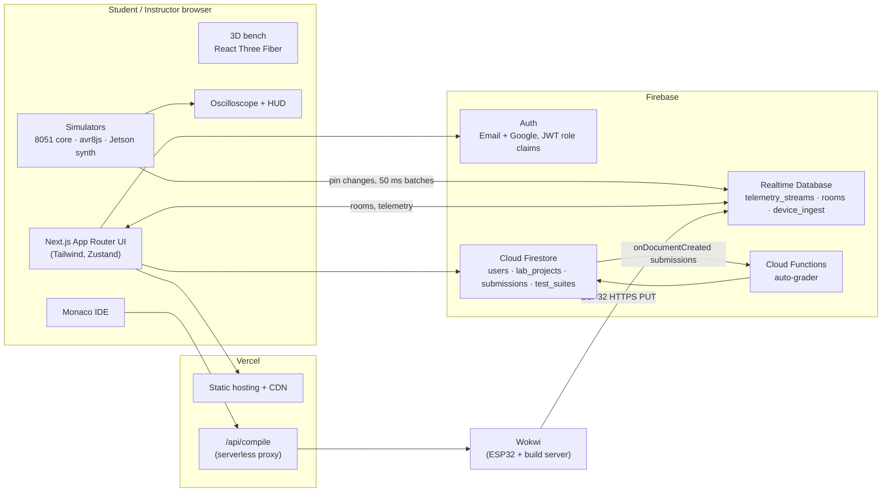

# Helios Lab — Cloud IoT & Embedded Systems Laboratory

**Live:** https://helioslab-five.vercel.app · **Release:** v1.0.0 · **License:** MIT

Helios Lab is a cloud-native virtual laboratory for embedded systems and IoT education. Students build circuits on an interactive 3D workbench, write firmware in a browser IDE, and run it on simulated hardware, from the 8-bit Intel 8051 up to an NVIDIA Jetson Edge AI tier. Live pin telemetry streams through Firebase. Instructors run collaborative lab rooms, and submissions are graded automatically by serverless Cloud Functions.

**Domain:** Education

---

## 1. Problem Statement

Hardware labs in embedded-systems courses face three recurring problems:

- **Cost and wear.** Microcontrollers, sensors and modules are fragile. Pins break, wiring burns out, and kits have to be replaced every semester.
- **Limited access.** Advanced platforms such as the NVIDIA Jetson are too expensive to give to every student, so most never use high-end IoT workflows.
- **Fragmented tools.** Existing web alternatives split the workflow across separate code editors, 2D schematic tools and submission portals.

**Target users:** engineering students, course instructors and TAs, and lab administrators.

**Why the cloud:** simulation runs on each student's own device, while the cloud provides identity, persistence, real-time sync, collaboration and grading. A lab can therefore serve thousands of students with no physical hardware and no servers to maintain.

---

## 2. Objectives

1. Provide a browser-based 3D lab bench that runs at 60 FPS on ordinary laptops.
2. Simulate four hardware tiers (8051, Arduino Uno, ESP32, Jetson Nano) with real firmware execution where possible.
3. Stream pin telemetry to the cloud in under 150 ms.
4. Enforce role-based access (guest, student, instructor, admin) at the database level.
5. Grade submissions automatically, without servers to manage.
6. Keep working through GPU failures and network loss.

---

## 3. Features

| Area | What it does |
|---|---|
| **3D workbench** | React Three Fiber bench with orbit and zoom, raycast selection, LED glow driven by live pin state, pressable buttons, and level-of-detail models |
| **Browser IDE** | Monaco editor with syntax highlighting for C/C++, 8051 Assembly and MicroPython; Cmd/Ctrl+Enter to run; example library; live re-flash on edit |
| **Intel 8051** | Custom TypeScript CPU core and two-pass assembler: Timer 0/1, interrupts, port inputs, pause/step debugging and a live register visualizer (ACC, B, PSW, DPTR, SP, R0–R7, ports) |
| **Arduino Uno** | Real AVR emulation using avr8js, with GPIO, PWM, timers and serial monitor; firmware is cached so repeat runs and offline runs are instant |
| **ESP32** | Runs in the Wokwi simulator and streams sensor data to Firebase over virtual Wi-Fi, authenticated with per-project device keys |
| **Jetson Nano** | Synthetic CSI camera stream with simulated TensorRT object detection (bounding boxes, confidence, FPS and inference latency), configured from `main.py` |
| **Virtual oscilloscope** | Dual-channel glassmorphism scope with timebase and volts/div controls, frequency and duty-cycle measurement, and simulator or Firebase as the data source |
| **Collaborative rooms** | An instructor hosts a room; students join with a 6-character code and follow the instructor's bench and camera in real time |
| **Submissions & auto-grader** | Students submit labs; a Cloud Function runs test suites and writes back the score and feedback; instructors review on a dashboard |
| **Reliability** | Automatic 2D schematic fallback on WebGL context loss or low FPS; offline drafts; Firestore offline cache; error tracking with Sentry |

---

## 4. System Architecture



**Design principle:** compute-heavy simulation runs on the client, and the cloud only handles identity, state, sync and grading. This keeps cloud costs flat as the number of users grows, and it means student firmware never runs on shared servers.

---

## 5. Cloud Services Used

| Service | Used for | Cloud concept |
|---|---|---|
| **Vercel** | Hosting, global CDN, preview deployments per branch, `/api/compile` serverless function, security headers | High availability, scalability |
| **Firebase Authentication** | Email/password and Google login; custom JWT claims (`role`) | Secure identity |
| **Cloud Firestore** | Users, projects, submissions, test suites; offline persistence cache | Scalable storage, offline resilience |
| **Firebase Realtime Database** | Pin telemetry, collaborative room state and camera, ESP32 device ingest | Real-time sync |
| **Cloud Functions (2nd gen)** | Auto-grader triggered by new submissions | Event-driven serverless |
| **Sentry** | Client error tracking | Observability |

### How the core cloud concepts are met

- **Scalability:** serverless hosting and managed databases, with no servers to provision. Simulation runs on clients, so cloud load scales with sync traffic, not CPU.
- **Real-time sync:** Realtime Database listeners for telemetry (batched every 50 ms), rooms (bench and camera broadcast) and ESP32 ingest.
- **Secure role-based access:** roles live in signed JWT claims and are enforced by Firestore and Realtime Database security rules, not just the UI.
- **High availability:** Vercel's global CDN plus Firebase's managed SLAs. Client-side fallbacks (2D view, offline drafts, cached firmware) keep the lab usable during partial outages.

---

## 6. Role-Based Access Control

| Role | Can | Cannot |
|---|---|---|
| **Guest** | Open the demo bench and run code | Save, submit or join rooms |
| **Student** | Create, save and run projects; submit labs; join rooms | Read other students' projects, grade, create rooms, publish templates |
| **Instructor / TA** | Everything a student can, plus: host rooms, view and grade all submissions, publish templates | Manage admin-only collections |
| **Admin** | Full access, including the chip catalog, demo projects and role assignment | — |

Roles are assigned with the Admin SDK (`scripts/set-role.mjs`). Users can never write their own role.

**Rules files:** [`firestore.rules`](firestore.rules) and [`database.rules.json`](database.rules.json)

---

## 7. Security Considerations

- **Rules enforced on the database.** Every read and write is checked by Firebase security rules. A tampered client cannot bypass them.
- **Students cannot grade themselves.** New submissions must have `status: "pending"` and `score: null`. Only staff or the Admin-SDK grader can change them.
- **Ownership is enforced.** Projects can't be reassigned to another owner. Telemetry streams can only be written by their owner.
- **ESP32 device keys.** Devices write only to `device_ingest/{key}`, and only numeric fields are accepted. Only the key's owner can read the data.
- **Sandboxed execution.** Student firmware runs inside in-browser emulators and isolated Cloud Function instances, never on shared servers.
- **Secrets kept out of the repo.** `.env.local` and `service-account.json` are gitignored. Environment variables are stored in Vercel.
- **HTTP security headers.** `X-Frame-Options: DENY`, `X-Content-Type-Options: nosniff`, `Referrer-Policy` and `Permissions-Policy` are set via [`vercel.json`](vercel.json).
- **Input validation.** The compile proxy rejects bad payloads and enforces a 100 KB size limit.

---

## 8. Reliability (SRE)

### Service Level Objectives

| SLO | Target | Measured | Evidence |
|---|---|---|---|
| Telemetry latency (cloud write round-trip) | 95% under 150 ms | `TODO` ms | HUD "Cloud write RTT" |
| Firmware build time | 98% under 2.5 s | `TODO` s | Toolbar "build ms" |
| 3D frame rate | 60 FPS at 1080p | `TODO` FPS | Chrome Performance panel |
| Unhandled client crash rate | under 0.1% of sessions | `TODO` | Sentry |
| Lighthouse (Performance / Accessibility / Best Practices) | — | `TODO` / `TODO` / `TODO` | Lighthouse report |

### Fallbacks

| Failure | Response |
|---|---|
| WebGL context lost, or FPS below 15 for 3 s | Automatic switch to the 2D schematic view, with a "Retry 3D" button |
| 3D renderer throws an error | React error boundary switches to the 2D view |
| Network offline | Firestore offline cache, local draft autosave every 800 ms, cached firmware builds |
| Build server unavailable | Cached firmware is used if the code hasn't changed; otherwise a clear error is shown |

---

## 9. Tech Stack

**Frontend:** Next.js 16 (App Router, Turbopack), React 19, TypeScript, Tailwind CSS 4, Zustand, React Three Fiber, drei, Monaco Editor
**Simulation:** custom 8051 core and assembler (TypeScript), avr8js, Wokwi (ESP32), canvas-based Jetson vision pipeline
**Backend:** Firebase Auth, Cloud Firestore, Realtime Database, Cloud Functions
**Hosting and operations:** Vercel, Sentry, GitHub
**Testing:** Vitest, Playwright, Lighthouse

---

## 10. Getting Started

### Prerequisites
- Node.js 24 LTS
- A Firebase project on the Blaze plan (needed for Cloud Functions)
- Firebase CLI (`npm i -g firebase-tools`)

### Setup
```bash
git clone https://github.com/TheNandinee/Helios-Lab.git
cd Helios-Lab
npm install
cp .env.example .env.local   # fill in your Firebase web config
npm run dev                  # http://localhost:3000
```

### Environment variables
| Variable | Description |
|---|---|
| `NEXT_PUBLIC_FIREBASE_API_KEY` … `NEXT_PUBLIC_FIREBASE_APP_ID` | Firebase web app config |
| `NEXT_PUBLIC_FIREBASE_DATABASE_URL` | Realtime Database URL |
| `NEXT_PUBLIC_WOKWI_PROJECT_ID` | Wokwi ESP32 project embedded in the ESP32 tier |

### Firebase
```bash
firebase login
firebase use <your-project-id>
firebase deploy --only firestore:rules,firestore:indexes,database
cd functions && npm install && cd ..
firebase deploy --only functions
```

### Roles and seed data
Place a service-account key at `./service-account.json` (it's gitignored), then run:
```bash
node scripts/set-role.mjs you@example.com admin   # roles: student | instructor | admin
node scripts/seed-templates.mjs                   # template + demo projects
```
After a role changes, the user must sign out and back in.

### Scripts
| Command | Purpose |
|---|---|
| `npm run dev` | Local dev server |
| `npm run build` | Production build (run before every push) |
| `npm test` | Unit tests (Vitest) |
| `npx playwright test` | End-to-end tests |

---

## 11. Project Structure

```
src/
  app/                 # routes: /, /login, /lab, /instructor, /api/compile
  components/
    bench/             # 3D workbench, 2D fallback, error boundary
    ide/               # Monaco editor, toolbar, serial console, project bar
    scope/             # oscilloscope
    jetson/            # Edge AI vision view
    rooms/             # collaborative rooms
    sim/               # ESP32 / Wokwi panels
    ui/                # palette, config modal, HUD, register visualizer
  lib/                 # firebase, projects, telemetry, rooms, submissions, offline
  sim/                 # 8051 core + assembler, AVR runner, Jetson config, traces, controller
  store/               # Zustand store
functions/             # Cloud Functions auto-grader
scripts/               # role assignment, seeding, wiring helpers
public/models/         # optimized GLB models with LOD variants
tests/                 # unit + e2e tests
docs/                  # architecture, decisions, report
```

---

## 12. Data Model

**Firestore**

| Collection | Key fields |
|---|---|
| `users/{uid}` | `email`, `displayName`, `created_at` |
| `lab_projects/{id}` | `owner_uid`, `name`, `hardware_architecture`, `diagram_json { components, wires }`, `source_code { filename: code }`, `is_template`, `created_at`, `updated_at` |
| `submissions/{id}` | `student_uid`, `project_id`, `hardware_architecture`, `source_code`, `status`, `score`, `feedback`, `submitted_at`, `graded_at` |
| `test_suites/{id}` | Grader test definitions per lab |
| `demo_projects/{id}` | Public guest labs |

**Realtime Database**

| Path | Purpose |
|---|---|
| `telemetry_streams/{streamId}` | `owner_uid`, `pins/{pin}: { value, ts }`, `updated_at` |
| `rooms/{code}` | `owner_uid`, `members`, `state` (bench + pins), `camera` |
| `device_keys/{key}` / `device_ingest/{key}` | ESP32 key ownership and incoming sensor data |

---

## 13. Limitations

- **Jetson tier is simulated.** It uses a synthetic camera stream and modeled inference latency, not real CUDA or TensorRT. Browsers can't run GPU binaries.
- **8051 is Assembly-only in the browser.** C for the 8051 would need the SDCC compiler running in the cloud.
- **ESP32 depends on Wokwi.** ESP32 execution and Arduino compilation rely on Wokwi's services.
- **Telemetry is readable by any signed-in user.** This trade-off keeps collaborative rooms simple. Per-room access lists would tighten it.
- **Desktop-first.** The 3D bench and IDE are designed for laptops. Mobile layouts are limited.

---

## 14. Future Enhancements

- **AI firmware co-pilot.** An LLM assistant in the IDE that explains compiler errors and suggests wiring fixes.
- **Hardware-in-the-loop.** Flash real microcontrollers on a physical bench through MQTT gateways, with live video feedback.
- **Mobile support.** A responsive touch layout and a companion PWA.
- **WebXR.** Immersive VR component placement and breadboard wiring.
- **More chips.** STM32, RP2040 and a cloud-side SDCC compiler for 8051 C.

---

## 15. Team

| Member | Role |
|---|---|
| **Nandinee** (Person 1) | Next.js shell, 3D workbench, all simulators and runtimes, Monaco IDE, Firebase (Auth, Firestore, Realtime DB, rules), telemetry, rooms, SRE fallbacks, Vercel deployment |
| **`TODO` Name** (Person 2) | 3D GLB models, GLSL shaders, UI icons and 2D schematic symbols, LOD optimization |
| **`TODO` Name** (Person 3) | Seed scripts, wiring helpers, Cloud Functions auto-grader, index optimization |
| **`TODO` Name** (Person 4) | Sentry, unit and E2E tests, performance benchmarking, documentation and final report |

### Contributing
Branch from `dev` using `feature/<name>-<task>`. Run `npm run build` before pushing, then open a pull request into `dev`. `dev` is merged into `main` for releases, and every push to `main` deploys to production.

---

## License

[MIT](LICENSE)
