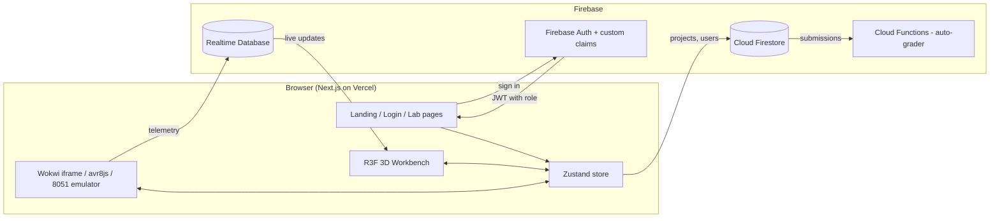

# System Architecture

## Overview
Helios Lab is a three-layer cloud application: a Next.js client served by Vercel's global edge network, an in-browser simulation layer, and Firebase managed services for identity, data, and serverless compute.

## Components
| Component | Location | Responsibility |
|---|---|---|
| AuthProvider | `src/components/auth` | Subscribes to auth state, reads the role claim, provisions the user profile |
| useLabStore | `src/store` | Single source of truth: user, role, bench components, selection |
| Workbench | `src/components/bench` | 3D scene, lighting, camera bounds, raycast selection, adaptive DPR |
| Palette / Inspector | `src/components/ui` | Add components, inspect/remove the selected component |
| WokwiPanel | `src/components/sim` | Embeds the simulator; origin-checked postMessage bridge |

## Data model
- **Firestore `users/{uid}`**: profile (`uid`, `email`, `displayName`, `created_at`). The role is never stored client-writable.
- **Firestore `lab_projects/{id}`**: `owner_uid`, `hardware_architecture`, `diagram_json`, `source_code`, timestamps
- **Firestore `demo_projects`, `submissions`, `test_suites`**: see `firestore.rules`
- **RTDB `telemetry_streams/{stream_id}`**: `owner_uid`, `pin_readings[]`, `sensor_metrics`

## Cloud concepts demonstrated
| Concept | Implementation |
|---|---|
| Scalability | Serverless Firebase back end and Vercel edge CDN; no servers to provision |
| Real-time sync | Realtime Database listeners for telemetry; Firestore live queries |
| Secure RBAC | JWT custom claims enforced in Firestore/RTDB security rules |
| High availability | Managed multi-zone Firebase services; Vercel global edge network |